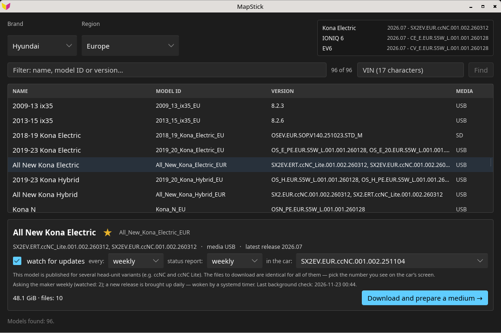
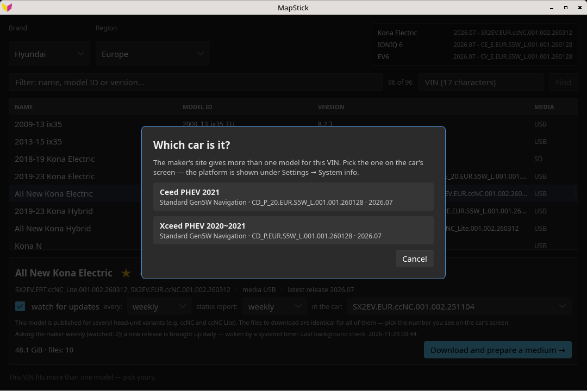
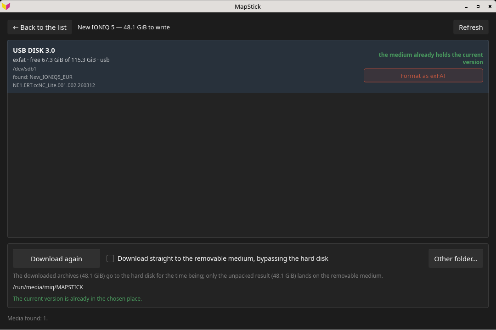

<p align="center">
  
</p>

<h1 align="center">MapStick</h1>

<p align="center">
  Navigation map updates for <b>Hyundai, Kia and Genesis</b> on a USB drive —<br>
  on Linux and Windows, without the official updater.
</p>

<p align="center">
  <b>English</b> · <a href="README.pl.md">Polski</a>
</p>

---

MapStick downloads the official navigation and infotainment software for your
car straight from the maker's update servers and puts it on a USB drive, ready
to plug into the car. It does what Hyundai's, Kia's and Genesis's *Navigation
Updater* does, plus a few things it doesn't:

- **it runs on Linux** (and on Windows),
- it tells you **how much space** the update needs **before** downloading
  anything,
- it writes **half as much** to the USB drive as the official tool and needs
  half the space on your hard disk,
- it can find your car **by VIN**, and keep an eye on it: it **notifies you**
  when a new map release comes out.



> [!NOTE]
> MapStick is an **unofficial** project. It is not affiliated with, endorsed by
> or supported by Hyundai Motor Company, Kia Corporation or Genesis. It uses the
> same public update service as the maker's own tools and downloads unmodified
> files. Hyundai, Kia and Genesis are trademarks of their respective owners.

## Contents

- [What it covers](#what-it-covers)
- [Features](#features)
- [Installation](#installation)
- [How to update your car](#how-to-update-your-car)
- [Background checks and notifications](#background-checks-and-notifications)
- [Privacy](#privacy)
- [FAQ](#faq)
- [Building from source](#building-from-source)
- [Credits and license](#credits-and-license)

## What it covers

MapStick covers the **infotainment head unit**: navigation with maps, and
Display Audio units without maps. It does not touch engine, gearbox, driver
assistance or instrument cluster software — those are not publicly
distributed and only a workshop can update them.

Cars that can update over the air can still be updated over USB. Over-the-air
updates need an active connected-services subscription once the free period
ends (for Hyundai Bluelink in Europe, three years from registration). The USB
route doesn't — and that is the route MapStick takes.

## Features

### Find your car

- **Brand and region.** Hyundai, Kia and Genesis in 13 regions: Europe, Brazil,
  Canada, India, Indonesia, Japan, Middle East, New Zealand, Russia and CIS,
  Singapore, South Korea, Türkiye and the United States. The model list loads
  as soon as you pick them.
- **Filter** the list by name, model ID or software version.
- **By VIN.** Type the 17-character VIN and MapStick asks the maker's update
  site which model it is, exactly as the site does when you use it in a
  browser. When the site offers more than one model for one VIN (it happens,
  for example, with some plug-in hybrids), you pick the one shown on the car's
  screen.
- **From the maker's site.** On Linux, MapStick opens the *Download* buttons on
  update.hyundai.com, update.kia.com and update.genesis.com — the links the
  official updater normally handles.



### See what you are getting

For the selected model, MapStick shows the software version (some models have
two head-unit variants, e.g. ccNC and ccNC Lite — both are in the same
download), the expected medium (USB or SD card), the release date, the number
of files and the **exact size** — counted file by file, because the total the
server reports is often zero or wrong.

### Prepare the drive

- **Safe drive detection.** Only external drives are listed. A drive is
  skipped if any of its partitions is marked as a system partition, if it holds
  an EFI boot partition, or if anything on it is mounted outside the usual
  places for removable media. The "removable" flag that the system reports is
  deliberately ignored — it is also set for a system installed on a USB SSD.
- **Mounting.** If your desktop doesn't mount drives by itself, MapStick does
  it — no password needed, just like a file manager.
- **Free space check** with a 15% margin, since the server's sizes are not
  always exact.
- **What is already on the drive.** MapStick reads the `.ver` file on the
  drive, so you see which model and version it holds — and the car's current
  version can be taken from there.
- **exFAT formatting**, only when you ask for it and only after a confirmation
  that names the drive, its model and its size. The safety check runs again on
  fresh data right before formatting. On Linux this goes through udisks and
  polkit, on Windows through the UAC prompt — no root, no admin shell.
- **Old maps are removed after success.** Files of the previous release that
  the new one no longer uses are deleted only once the new download is
  complete, so a failed download never leaves the drive without a working
  version.



### Download

- **Half the writes to the drive.** The update comes as split zip archives.
  The official updater downloads everything to the computer first and copies
  it to the drive afterwards. Writing the archives straight to the drive would
  write everything twice. MapStick keeps the archives on the hard disk and
  unpacks them onto the drive **while the next archives are downloading**, so
  the drive gets each byte once, the hard disk needs half the space, and there
  is no separate copying phase at the end.
- **Resume, pause, cancel.** An interrupted download continues where it
  stopped. *Cancel and clean up* removes the partial archives.
- **Checksums** of every file are verified while downloading.
- **Progress** shows downloading and unpacking separately, with the speed.
- **Directly to the drive** is still available as an option, for when there
  is no room on the hard disk.
- **Download now, copy later.** Download to a folder on the hard disk and copy
  — or move — it onto a drive whenever you plug one in. The copy goes to a
  hidden folder first and the `.ver` file is placed last, so a drive pulled out
  halfway never looks like a finished update to the car.

### Keep track

- **Favourites** keep your cars at hand, with the newest release for each.
- **The version in your car.** MapStick reads it from the drive you last used
  or lets you pick it from the list of known versions. It never claims "up to
  date" when it doesn't know — an unknown version stays unknown.
- **Watch for updates** — see [below](#background-checks-and-notifications).

### Everywhere

- Interface in **English, Polish, German, French, Spanish, Brazilian
  Portuguese and Korean**, following the system language.
- **Linux** (udisks2 + polkit) and **Windows 10/11**. On Windows without a
  working OpenGL 2 driver (some virtual machines, Remote Desktop) MapStick
  switches to a software renderer by itself.
- **macOS** builds from source, but has no drive support yet: download into a
  folder and copy it yourself.

## Installation

### Arch Linux and derivatives

From the AUR, as a ready binary or built from source:

```sh
yay -S mapstick-bin   # or: yay -S mapstick
```

### Other Linux distributions

Download `mapstick-<version>-x86_64-linux.tar.gz` from the
[latest release](https://github.com/MikolajQ/mapstick/releases/latest), unpack
it and install it for your user:

```sh
tar xf mapstick-*-x86_64-linux.tar.gz
cd mapstick-*-x86_64-linux
./install.sh              # into ~/.local; ./install.sh --uninstall removes it
```

MapStick needs **udisks2** for drive detection (preinstalled on most desktop
distributions) and a **polkit** agent for formatting. exFAT formatting needs
**exfatprogs**. Background checks use a systemd user timer, falling back to
cron or a login autostart entry.

### Windows

Download `MapStick-<version>-setup.exe` from the
[latest release](https://github.com/MikolajQ/mapstick/releases/latest) and run
it. It installs for your user only and doesn't need administrator rights. A
portable `.zip` is there as well.

The installer is not code-signed, so Windows SmartScreen may warn about an
unknown publisher: choose **More info → Run anyway**.

## How to update your car

1. **Find the car**: pick the brand and region and select the model, or type
   the VIN and press *Find*. The version the car has is shown on the system
   information screen in the car's settings.
2. Press **Download and prepare a medium →**.
3. **Plug in a USB drive** and pick it from the list. If it isn't exFAT, or is
   too small, MapStick tells you; format it from there if you like.
4. Press **Download** and wait. You can pause and resume at any time.
5. **Take the drive to the car**, plug it into the USB port while the car is
   on, and follow the instructions on the screen. A map update can take quite
   a while; keep the car on until it finishes. The car checks the files itself
   before installing.

Keep the drive: next time MapStick reads it, knows which version the car got,
and removes only the files the new release doesn't need.

## Background checks and notifications

Star a car (*Add to favourites*) and tick **watch for updates**. MapStick then
sets up a daily check that runs without the window open — a systemd user timer
on Linux, a Task Scheduler task on Windows:

- It asks the maker for new releases **daily, weekly or monthly** (your
  choice; weekly by default). The maker publishes map updates a few times a
  year.
- When a release your car doesn't have appears, you get a notification —
  **every day** until you copy it onto a drive or mark the car as having it.
  On Linux the notification has *Show* and *The car already has it* buttons.
- A **status report** comes weekly (or daily, monthly or never — *status
  report:*) with the watched cars and the last answer from the maker. Its
  absence is the signal that something is wrong.
- An **alarm** comes daily when the maker hasn't answered for longer than the
  check interval plus three days, even with status reports switched off.
- If the check can't even start — for example after the program was moved or
  removed — systemd shows a notification about that too. Opening MapStick once
  sets the schedule up again.

The check runs for a fraction of a second, needs about 3 MB of memory and
leaves nothing running in between. On Linux, look at it with:

```sh
systemctl --user list-timers mapstick-check.timer
journalctl --user -u mapstick-check.service
```

## Privacy

- MapStick talks only to the maker's servers: the update catalogue (the same
  one the official updater uses) and, for VIN search and *Download* links, the
  update sites of Hyundai, Kia and Genesis. There is no telemetry and no
  account.
- A VIN is sent only to the maker's update site, the same way the site sends
  it, and is never written to a log or a file.
- Settings and favourites live in `~/.config/mapstick/favourites.json` on Linux
  and `%APPDATA%\mapstick\` on Windows. Downloads in progress are kept in
  `~/.cache/mapstick/` (`%LOCALAPPDATA%\mapstick\` on Windows).

## FAQ

**Can this break my car?**
The car checks the update files before installing them and refuses damaged
ones; MapStick downloads unmodified files from the maker and verifies their
checksums. Follow the car's instructions during the update — mostly: keep it
on until the update finishes.

**Why exFAT?**
That is what the cars expect, and FAT32 can't hold files over 4 GB — some
update files are larger.

**Can I use one drive for two cars?**
Files go to the root of the drive, as the cars expect, and each model has its
own set. MapStick removes only files listed by the model's own `.ver` file, but
a drive per car is simpler.

**Where is the `UPDATE` folder?**
There isn't one: the files go to the root of the drive.

**Is there a command line version?**
MapStick is built on [nudl](https://github.com/chenxiaolong/nudl), a command
line tool that does the downloading. If you prefer a terminal, use nudl
directly.

## Building from source

You need Rust 1.88 or newer. On Linux also the development headers of
fontconfig, xkbcommon, Wayland and libudev (Debian/Ubuntu:
`libfontconfig1-dev libxkbcommon-dev libwayland-dev libudev-dev`).

```sh
git clone https://github.com/MikolajQ/mapstick.git
cd mapstick
cargo build --release
```

The program is `target/release/mapstick`. `mapstick --help` lists the command
line options.

MapStick depends on a [fork of nudl](https://github.com/MikolajQ/nudl/tree/mapstick)
that adds a library API and a separate working directory for downloaded
archives; Cargo fetches it by itself. Comments in the source code are in
Polish.

## Credits and license

- [nudl](https://github.com/chenxiaolong/nudl) by Andrew Gunnerson does the
  real work: talking to the update service, downloading, verifying and
  unpacking. MapStick would not exist without it.
- The interface is made with [Slint](https://slint.dev).

MapStick is free software under the [GNU GPL v3](LICENSE) (GPL-3.0-only).
