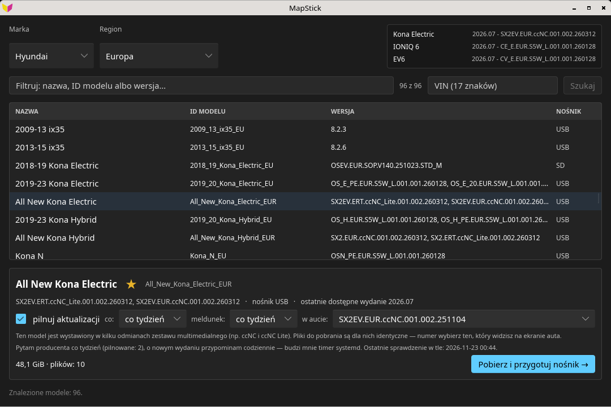
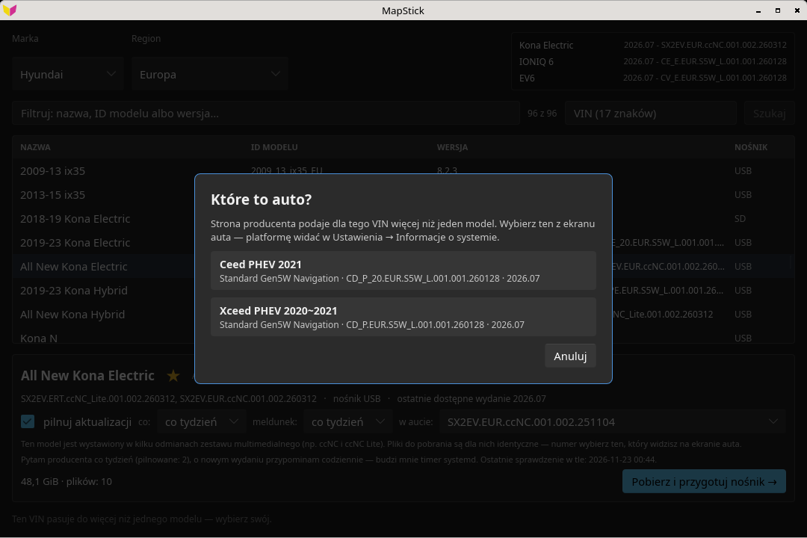

<p align="center">
  
</p>

<h1 align="center">MapStick</h1>

<p align="center">
  Aktualizacje map nawigacji <b>Hyundaia, Kii i Genesisa</b> na pendrive —<br>
  na Linuksie i Windows, bez oficjalnego programu producenta.
</p>

<p align="center">
  <a href="README.md">English</a> · <b>Polski</b>
</p>

---

MapStick pobiera oficjalne oprogramowanie nawigacji i multimediów prosto z
serwerów aktualizacji producenta i przygotowuje z niego pendrive, który
wystarczy włożyć do auta. Robi to samo co *Navigation Updater* Hyundaia, Kii
i Genesisa, a do tego kilka rzeczy, których on nie umie:

- **działa na Linuksie** (i na Windows),
- **przed pobraniem** mówi, **ile miejsca** potrzeba,
- zapisuje na pendrive **o połowę mniej** danych niż oficjalny program
  i zajmuje o połowę mniej miejsca na dysku komputera,
- znajduje auto **po numerze VIN** i pilnuje go: **daje znać**, gdy wyjdzie
  nowe wydanie map.



> [!NOTE]
> MapStick to projekt **nieoficjalny**. Nie jest związany z Hyundai Motor
> Company, Kia Corporation ani Genesis, nie jest przez nie wspierany ani
> zatwierdzony. Korzysta z tego samego publicznego serwisu aktualizacji co
> programy producenta i pobiera niezmienione pliki. Hyundai, Kia i Genesis są
> znakami towarowymi swoich właścicieli.

## Spis treści

- [Czego dotyczy](#czego-dotyczy)
- [Funkcje](#funkcje)
- [Instalacja](#instalacja)
- [Jak zaktualizować auto](#jak-zaktualizować-auto)
- [Sprawdzanie w tle i powiadomienia](#sprawdzanie-w-tle-i-powiadomienia)
- [Prywatność](#prywatność)
- [Pytania i odpowiedzi](#pytania-i-odpowiedzi)
- [Budowanie ze źródeł](#budowanie-ze-źródeł)
- [Podziękowania i licencja](#podziękowania-i-licencja)

## Czego dotyczy

MapStick obsługuje **system multimedialny**: nawigację z mapami oraz radia
Display Audio bez map. Nie dotyka oprogramowania silnika, skrzyni biegów,
systemów wspomagania kierowcy ani zegarów — tego producent publicznie nie
udostępnia i aktualizuje to wyłącznie serwis.

Auta, które umieją aktualizować się przez internet (OTA), nadal można
aktualizować przez USB. Aktualizacje OTA wymagają aktywnej subskrypcji usług
online, gdy skończy się okres bezpłatny (w przypadku Hyundai Bluelink
w Europie — trzy lata od rejestracji). Droga przez pendrive takiego warunku
nie ma — i to nią idzie MapStick.

## Funkcje

### Znajdź swoje auto

- **Marka i region.** Hyundai, Kia i Genesis w 13 regionach: Europa, Brazylia,
  Bliski Wschód, Indie, Indonezja, Japonia, Kanada, Korea Południowa, Nowa
  Zelandia, Rosja i WNP, Singapur, Turcja i Stany Zjednoczone. Lista modeli
  wczytuje się od razu po wyborze.
- **Filtr** po nazwie, identyfikatorze modelu albo wersji oprogramowania.
- **Po VIN.** Wpisz 17-znakowy numer VIN, a MapStick zapyta stronę
  aktualizacji producenta, jaki to model — dokładnie tak, jak robi to ta
  strona w przeglądarce. Gdy strona podaje dla jednego numeru kilka modeli
  (zdarza się to np. przy niektórych hybrydach plug-in), wybierasz ten, który
  widać na ekranie auta.
- **Prosto ze strony producenta.** Na Linuksie MapStick obsługuje przyciski
  *Download* na update.hyundai.com, update.kia.com i update.genesis.com —
  odnośniki, które zwykle otwiera oficjalny program.



### Zobacz, co pobierasz

Dla wybranego modelu MapStick pokazuje wersję oprogramowania (niektóre modele
mają dwie odmiany zestawu multimedialnego, np. ccNC i ccNC Lite — obie są
w tym samym pobraniu), rodzaj nośnika (USB albo karta SD), datę wydania,
liczbę plików i **dokładny rozmiar** — liczony plik po pliku, bo suma podawana
przez serwer bywa zerowa albo błędna.

### Przygotuj pendrive

- **Bezpieczne wykrywanie nośników.** Na liście są tylko dyski zewnętrzne.
  Dysk zostaje pominięty, jeśli którakolwiek jego partycja jest oznaczona jako
  systemowa, jeśli ma partycję rozruchową EFI albo jeśli cokolwiek na nim jest
  zamontowane poza zwykłymi miejscami dla nośników wymiennych. Flaga
  „wymienny”, którą zgłasza system, jest celowo ignorowana — ma ją też system
  zainstalowany na dysku SSD podłączonym przez USB.
- **Montowanie.** Jeśli pulpit sam nie montuje nośników, robi to MapStick —
  bez hasła, tak samo jak menedżer plików.
- **Sprawdzenie wolnego miejsca** z 15% zapasu, bo rozmiary z serwera nie
  zawsze są dokładne.
- **Co już jest na pendrivie.** MapStick czyta plik `.ver` na nośniku, więc
  widzisz, jaki model i jaka wersja na nim leżą — i stąd może wziąć wersję,
  którą ma auto.
- **Formatowanie do exFAT** tylko na Twoje życzenie i dopiero po
  potwierdzeniu, które pokazuje nazwę, model i pojemność nośnika. Tuż przed
  formatowaniem sprawdzenie bezpieczeństwa powtarza się na świeżych danych.
  Na Linuksie przez udisks i polkit, na Windows przez okno UAC — bez roota
  i bez konsoli administratora.
- **Stare mapy znikają dopiero po sukcesie.** Pliki poprzedniego wydania,
  których nowe już nie używa, są usuwane dopiero, gdy nowe pobranie jest
  kompletne — nieudane pobranie nigdy nie zostawi pendrive'a bez działającej
  wersji.

### Pobieranie

- **Połowa zapisów na pendrive.** Aktualizacja przychodzi jako dzielone
  archiwa zip. Oficjalny program pobiera wszystko na komputer i dopiero potem
  kopiuje na pendrive. Zapis archiwów prosto na pendrive oznaczałby zapisanie
  wszystkiego dwa razy. MapStick trzyma archiwa na dysku komputera
  i rozpakowuje je na pendrive **w trakcie pobierania kolejnych**, więc każdy
  bajt trafia na pendrive raz, dysk potrzebuje połowy miejsca, a na końcu nie
  ma osobnego etapu kopiowania.
- **Wznawianie, wstrzymywanie, anulowanie.** Przerwane pobieranie rusza od
  miejsca, w którym stanęło. *Anuluj i posprzątaj* usuwa niepełne archiwa.
- **Sumy kontrolne** każdego pliku są sprawdzane w trakcie pobierania.
- **Postęp** pokazuje osobno pobieranie i rozpakowywanie, z prędkością.
- **Prosto na pendrive** — opcja na wypadek braku miejsca na dysku.
- **Pobierz teraz, skopiuj później.** Pobierz do katalogu na dysku i skopiuj
  — albo przenieś — na pendrive, kiedy go podłączysz. Kopia trafia najpierw do
  ukrytego katalogu, a plik `.ver` jest kładziony na końcu, więc pendrive
  wyjęty w połowie nigdy nie wygląda dla auta na gotową aktualizację.

### Pilnuj

- **Ulubione** trzymają Twoje auta pod ręką, z najnowszym wydaniem dla
  każdego.
- **Wersja w aucie.** MapStick odczytuje ją z pendrive'a, którego użyłeś
  ostatnio, albo pozwala wybrać ją z listy znanych wersji. Nigdy nie twierdzi
  „masz aktualne”, jeśli tego nie wie — nieznana wersja zostaje nieznana.
- **Pilnowanie aktualizacji** — opisane [niżej](#sprawdzanie-w-tle-i-powiadomienia).

### Wszędzie

- Interfejs **po polsku, angielsku, niemiecku, francusku, hiszpańsku,
  portugalsku (Brazylia) i koreańsku**, zgodnie z językiem systemu.
- **Linux** (udisks2 + polkit) i **Windows 10/11**. Na Windows bez
  działającego sterownika OpenGL 2 (niektóre maszyny wirtualne, Pulpit
  zdalny) MapStick sam przełącza się na renderowanie programowe.
- **macOS** buduje się ze źródeł, ale nie obsługuje jeszcze nośników: pobierz
  do katalogu i skopiuj samodzielnie.

## Instalacja

### Arch Linux i pochodne

Z AUR, jako gotowa binarka albo budowany ze źródeł:

```sh
yay -S mapstick-bin   # albo: yay -S mapstick
```

### Inne dystrybucje Linuksa

Pobierz `mapstick-<wersja>-x86_64-linux.tar.gz` z
[najnowszego wydania](https://github.com/MikolajQ/mapstick/releases/latest),
rozpakuj i zainstaluj dla swojego użytkownika:

```sh
tar xf mapstick-*-x86_64-linux.tar.gz
cd mapstick-*-x86_64-linux
./install.sh              # do ~/.local; ./install.sh --uninstall usuwa
```

MapStick potrzebuje **udisks2** do wykrywania nośników (jest w większości
dystrybucji z pulpitem) i agenta **polkit** do formatowania. Formatowanie do
exFAT wymaga pakietu **exfatprogs**. Sprawdzanie w tle korzysta z timera
użytkownika systemd, a bez niego z crona albo z uruchamiania przy logowaniu.

### Windows

Pobierz `MapStick-<wersja>-setup.exe` z
[najnowszego wydania](https://github.com/MikolajQ/mapstick/releases/latest)
i uruchom. Instaluje się tylko dla Twojego użytkownika i nie wymaga uprawnień
administratora. Jest też przenośna wersja `.zip`.

Instalator nie jest podpisany cyfrowo, więc Windows SmartScreen może ostrzec
o nieznanym wydawcy: wybierz **Więcej informacji → Uruchom mimo to**.

## Jak zaktualizować auto

1. **Znajdź auto**: wybierz markę i region, a potem model — albo wpisz VIN
   i naciśnij *Szukaj*. Wersję, którą ma auto, pokazuje ekran informacji
   o systemie w ustawieniach auta.
2. Naciśnij **Pobierz i przygotuj nośnik →**.
3. **Podłącz pendrive** i wybierz go z listy. Jeśli nie jest w exFAT albo jest
   za mały, MapStick to powie; stamtąd możesz go też sformatować.
4. Naciśnij **Pobierz** i poczekaj. W każdej chwili możesz wstrzymać i wznowić.
5. **Zanieś pendrive do auta**, włóż go do portu USB przy włączonym aucie
   i postępuj zgodnie z instrukcjami na ekranie. Aktualizacja map potrafi
   trochę potrwać — nie wyłączaj auta, dopóki się nie skończy. Auto samo
   sprawdza pliki przed instalacją.

Zachowaj pendrive: następnym razem MapStick go odczyta, będzie wiedział, jaką
wersję dostało auto, i usunie tylko te pliki, których nowe wydanie nie
potrzebuje.

## Sprawdzanie w tle i powiadomienia

Dodaj auto do ulubionych (*Dodaj do ulubionych*) i zaznacz **pilnuj
aktualizacji**. MapStick zakłada wtedy codzienne sprawdzanie, które działa bez
otwartego okna — na Linuksie timer użytkownika systemd, na Windows zadanie
w Harmonogramie zadań:

- Pyta producenta o nowe wydania **codziennie, co tydzień albo co miesiąc**
  (do wyboru; domyślnie co tydzień). Producent wydaje mapy kilka razy w roku.
- Gdy pojawi się wydanie, którego auto nie ma, dostajesz powiadomienie —
  **codziennie**, dopóki nie skopiujesz go na pendrive albo nie zaznaczysz, że
  auto już je ma. Na Linuksie powiadomienie ma przyciski *Pokaż* i *Auto już
  to ma*.
- **Meldunek** przychodzi co tydzień (albo codziennie, co miesiąc lub nigdy —
  pole *meldunek:*) z listą pilnowanych aut i datą ostatniej odpowiedzi
  producenta. Jego brak jest sygnałem, że coś jest nie tak.
- **Alarm** przychodzi codziennie, gdy producent nie odpowiada dłużej niż
  odstęp sprawdzania plus trzy dni — nawet przy wyłączonych meldunkach.
- Jeśli sprawdzanie nie może nawet wystartować — na przykład po przeniesieniu
  albo usunięciu programu — powiadomienie o tym wyświetli sam systemd.
  Jednokrotne otwarcie MapSticka zakłada harmonogram na nowo.

Sprawdzenie trwa ułamek sekundy, potrzebuje około 3 MB pamięci i między
uruchomieniami nie zostawia żadnego procesu. Na Linuksie podejrzysz je tak:

```sh
systemctl --user list-timers mapstick-check.timer
journalctl --user -u mapstick-check.service
```

## Prywatność

- MapStick łączy się wyłącznie z serwerami producenta: z katalogiem
  aktualizacji (tym samym, którego używa oficjalny program) oraz — przy
  wyszukiwaniu po VIN i odnośnikach *Download* — ze stronami aktualizacji
  Hyundaia, Kii i Genesisa. Nie ma telemetrii ani konta.
- VIN trafia wyłącznie na stronę aktualizacji producenta, tak samo jak
  wysyła go ta strona, i nigdy nie jest zapisywany w dzienniku ani w pliku.
- Ustawienia i ulubione leżą w `~/.config/mapstick/favourites.json` na
  Linuksie i w `%APPDATA%\mapstick\` na Windows. Niedokończone pobrania —
  w `~/.cache/mapstick/` (na Windows `%LOCALAPPDATA%\mapstick\`).

## Pytania i odpowiedzi

**Czy to może zepsuć auto?**
Auto sprawdza pliki aktualizacji przed instalacją i odrzuca uszkodzone;
MapStick pobiera niezmienione pliki od producenta i sprawdza ich sumy
kontrolne. W trakcie aktualizacji postępuj zgodnie z instrukcjami auta —
przede wszystkim: nie wyłączaj go, dopóki aktualizacja się nie skończy.

**Dlaczego exFAT?**
Tego oczekują auta, a FAT32 nie pomieści plików większych niż 4 GB — niektóre
pliki aktualizacji są większe.

**Czy jeden pendrive wystarczy na dwa auta?**
Pliki trafiają do głównego katalogu nośnika, tak jak oczekują tego auta,
a każdy model ma własny zestaw. MapStick usuwa tylko pliki wymienione
w pliku `.ver` danego modelu, ale pendrive na auto to prostsze rozwiązanie.

**Gdzie jest katalog `UPDATE`?**
Nie ma go: pliki trafiają do głównego katalogu pendrive'a.

**Czy jest wersja do wiersza poleceń?**
MapStick jest zbudowany na [nudl](https://github.com/chenxiaolong/nudl) —
narzędziu wiersza poleceń, które zajmuje się pobieraniem. Jeśli wolisz
terminal, użyj nudl bezpośrednio.

## Budowanie ze źródeł

Potrzebny jest Rust 1.88 lub nowszy. Na Linuksie także nagłówki fontconfig,
xkbcommon, Wayland i libudev (Debian/Ubuntu:
`libfontconfig1-dev libxkbcommon-dev libwayland-dev libudev-dev`).

```sh
git clone https://github.com/MikolajQ/mapstick.git
cd mapstick
cargo build --release
```

Program to `target/release/mapstick`. `mapstick --help` wypisuje opcje
wiersza poleceń.

MapStick korzysta z [forka nudl](https://github.com/MikolajQ/nudl/tree/mapstick),
który dodaje API biblioteki i osobny katalog roboczy na pobierane archiwa;
Cargo pobierze go sam. Komentarze w kodzie są po polsku.

## Podziękowania i licencja

- [nudl](https://github.com/chenxiaolong/nudl) autorstwa Andrew Gunnersona
  wykonuje właściwą pracę: rozmawia z serwisem aktualizacji, pobiera,
  sprawdza i rozpakowuje. Bez niego MapSticka by nie było.
- Interfejs powstał w [Slint](https://slint.dev).

MapStick jest wolnym oprogramowaniem na licencji [GNU GPL v3](LICENSE)
(GPL-3.0-only).
